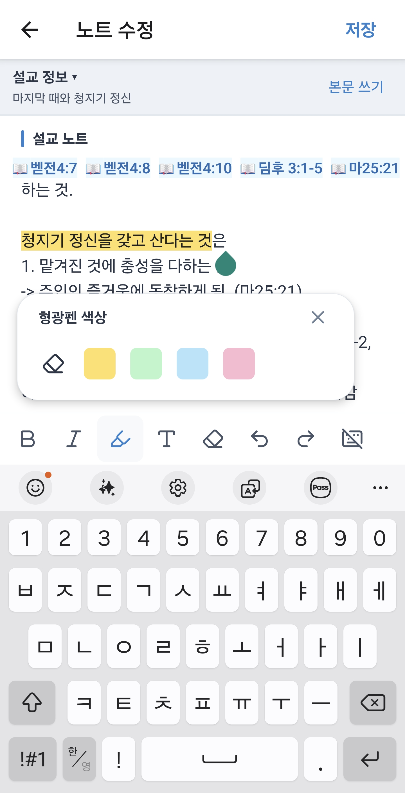
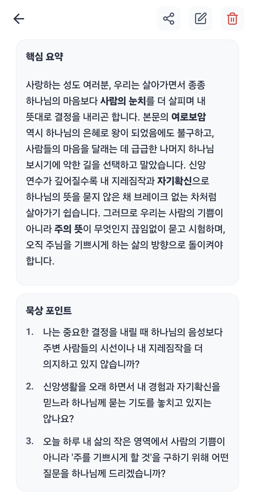
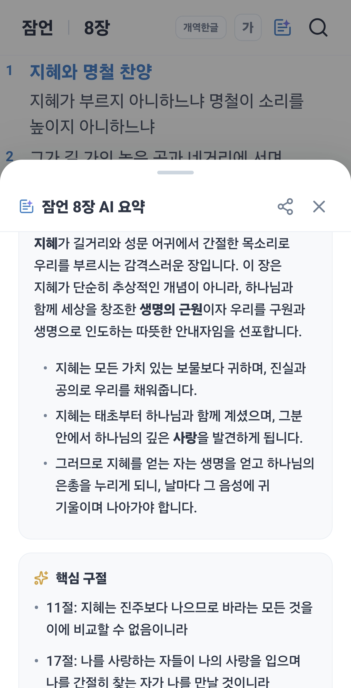

# 설교노트 AI

설교를 들으며 작성한 기록을 다시 읽고 묵상할 수 있도록 만든 Android 앱입니다. 직접 적은 노트를 AI가 요약하고 묵상 질문을 제안합니다.

[Google Play에서 보기](https://play.google.com/store/apps/details?id=com.sermonnote.app)

이 저장소에서는 설교노트AI의 기능과 개발 과정을 소개합니다.

## 앱 화면

<table>
  <thead>
    <tr>
      <th width="33%" align="center">노트 편집</th>
      <th width="33%" align="center">설교 노트 AI 분석</th>
      <th width="33%" align="center">성경 본문 AI 요약</th>
    </tr>
  </thead>
  <tbody>
    <tr>
      <td align="center" valign="top"></td>
      <td align="center" valign="top"></td>
      <td align="center" valign="top"></td>
    </tr>
    <tr>
      <td align="center">서식과 성경 구절을 넣어 기록합니다.</td>
      <td align="center">노트의 핵심을 요약하고 묵상 질문을 제안합니다.</td>
      <td align="center">성경 본문의 핵심을 AI 요약으로 확인합니다.</td>
    </tr>
  </tbody>
</table>

## 만들게 된 이유

설교를 들으며 휴대폰에 메모했지만, 기록이 길어지고 여기저기 흩어져 다시 읽기 어려웠습니다. 설교에 나온 성경 구절을 찾아보는 과정도 번거로웠습니다.

직접 쓸 수 있는 앱을 만들고 싶었습니다. 한곳에 기록을 모으고, 말씀을 바로 찾아 읽고, AI 요약과 묵상 질문을 통해 노트를 다시 꺼내 읽을 수 있도록 설교노트AI를 개발했습니다.

## 주요 기능

- **노트 작성과 검색:** 설교 기록을 작성하고 태그로 분류해 찾을 수 있습니다.
- **오프라인 성경 검색:** 앱에 내장한 SQLite 데이터베이스에서 성경 본문을 검색합니다.
- **성경 구절 연결:** 노트에 적은 성경 구절을 인식하고 해당 말씀으로 연결합니다.
- **AI 노트 분석:** 사용자가 작성한 노트의 핵심을 요약하고 묵상 질문을 제안합니다.
- **백업과 복원:** Supabase를 이용해 기록을 클라우드에 백업하고 복원합니다.

## 담당한 일과 출시

개인 프로젝트로 문제 정의, 기획, 앱과 AI 백엔드 개발, Android 빌드, 스토어 출시를 직접 진행했습니다. Google Play 출시일은 2026년 3월 25일입니다.

## 운영 현황

별도 광고 집행 없이 서비스를 출시하고 운영하고 있습니다.

| 지표 | 수치 | 기준 |
|---|---:|---|
| 누적 설치 수 | 294회 | 2026년 10월 17일 기준 |
| 활성 기기 수 | 약 100대 | 2026년 10월 17일 기준, 최근 28일 평균 101대 |

출처는 Google Play Console입니다. 활성 기기 수는 앱이 설치되어 있고 사용 중인 기기의 수이며, 사용자 수와는 다를 수 있습니다.

## 기술 스택

| 영역 | 기술 |
|---|---|
| 모바일 앱 | React Native, Expo SDK 54, TypeScript |
| 화면 라우팅 | Expo Router |
| 로컬 데이터 | SQLite, expo-sqlite |
| 인증과 클라우드 백업 | Supabase |
| AI 분석 | Gemini API |
| AI 백엔드 | Expo Router API Routes, Vercel |
| Android 빌드 | EAS Build |

## 개발 과정에서 다룬 문제

### 인터넷 없이 사용할 수 있는 기록과 성경 검색

예배 중 네트워크 연결에 의존하지 않고 기록하고 말씀을 찾을 수 있도록 노트와 성경 데이터를 SQLite에 저장했습니다. AI 분석과 클라우드 백업은 네트워크 연결이 있을 때 사용하는 기능으로 구성했습니다.

### 노트와 태그의 일관된 저장

노트 본문과 태그 연결을 하나의 트랜잭션으로 저장하도록 구현했습니다. 저장 도중 오류가 발생했을 때 일부 항목만 반영되는 상황을 막기 위한 설계입니다.

### AI 응답 형식의 예외 처리

AI에는 마크다운 요약과 JSON 메타데이터를 함께 요청합니다. 구분자가 없는 JSON 응답과 일반 텍스트 응답을 처리하는 대체 경로도 구현했습니다. 응답을 정규화한 뒤 필수 요약이 있는지 확인하고 화면에 전달합니다.

### 인증과 사용량 제한

Gemini 호출은 서버의 API Route에서 수행하고, API 키도 서버에서 읽습니다. AI 요청에는 Supabase 인증, 사용자별 일일 사용량 확인, 본문 길이 검증을 적용했습니다. 앱에서는 네트워크 연결과 요청 시간 초과를 처리합니다.

### 기존 노트와 서식 노트의 호환

노트에 서식을 추가하면서 기존 데이터베이스의 본문 필드를 유지했습니다. 기존 일반 텍스트와 새로운 서식 본문을 구분해 읽고, 백업과 복원에서도 저장 형식을 보존하도록 구현했습니다.

## 배운 점과 다음 개선

개인적인 불편에서 출발한 아이디어를 실제 앱으로 출시하면서, 기능 구현과 함께 기록 저장, AI 응답 실패, 인증, 사용량 관리까지 다루게 되었습니다.

다음으로는 AI 분석 결과에 대한 사용자 피드백을 수집하고, 노트 작성과 AI 분석의 이용 흐름, 재방문을 측정하려고 합니다. 요약이 실제로 기록을 다시 읽는 데 도움이 되는지 확인하고 개선하는 것이 목표입니다.

